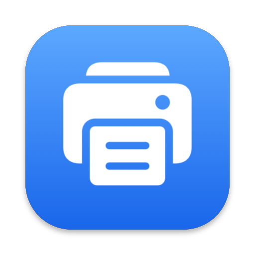

<p align="center">
  
</p>

<h1 align="center">Print G2010</h1>

<p align="center"><b>แอปสั่งพิมพ์ Canon PIXMA G2010 สำหรับ Mac ที่ใช้ชิป Apple Silicon</b></p>

<p align="center">
  
  
  
  
  
  
</p>

<p align="center"><a href="#features">Features</a> · <a href="#download">Download</a> · <a href="#licenses">Licenses</a> · <a href="#requirement">Requirement</a></p>

<p align="center"><a href="README.md">English</a> &nbsp;|&nbsp; <b>ภาษาไทย</b></p>

---

โปรเจกต์นี้แก้ปัญหาเครื่องพิมพ์ **Canon PIXMA G2010** ที่ไม่มีไดรเวอร์สำหรับ Mac ที่ใช้ Apple Silicon
สำหรับคนทำงานหรือใครก็ตามที่ใช้เครื่องรุ่นนี้ (พบได้บ่อยตามสำนักงานเพราะราคาค่อนข้างถูก)
ต่อเครื่องพิมพ์ผ่านสาย USB (อาจต้องใช้หัวแปลง USB to USB-C) แล้วสั่งพิมพ์เอกสารผ่านแอปนี้ได้เลย

ตอนนี้รองรับเฉพาะไฟล์เอกสารที่เป็น .pdf เท่านั้น

<a id="features"></a>

## Features

- ลากไฟล์มาวาง หรือเลือกไฟล์ผ่านหน้า Dialog ติ๊กไฟล์ที่ต้องการ แล้วกดพิมพ์
- เลือกจำนวนชุดและหน้าของแต่ละไฟล์ได้ ทุกหน้า เลขคี่ เลขคู่ หรือระบุเอง เช่น `1, 3, 5-9`
- พิมพ์จากหน้าสุดท้ายก่อน กองกระดาษที่ออกมาจึงเรียงหน้า 1 อยู่บนสุด
- บอกสถานะเครื่องพิมพ์ และต่อคิวหลายไฟล์ได้
- ลากไฟล์ในหน้ารายการไฟล์เพื่อสลับลำดับการพิมพ์
- สแกนจากกระจกในหน้าต่างของตัวเอง เลือกสี เทา หรือขาวดำ ความละเอียด 75 ถึง 600 dpi สแกนหลายหน้าต่อเนื่องได้ ลบหน้าที่ไม่ต้องการได้ แล้วบันทึกเป็น PDF ไฟล์เดียว PDF แยกหน้าละไฟล์ หรือเป็นรูป PNG/JPEG/TIFF

**หมายเหตุ:** ไฟล์ Word และ Pages แปลงเป็น PDF ก่อน

<a id="download"></a>

## Download

<p align="Left">
  <a href="../../releases/latest"></a>
</p>

โหลดไฟล์ `.dmg` ล่าสุดจาก [Releases](../../releases) เปิดแล้วลาก **Print G2010** ไปไว้ที่ Applications

แอปผ่านการ sign และ notarize จาก Apple แล้ว เปิดใช้ได้เหมือนแอป Mac ทั่วไป

ต้องใช้ Mac ชิป Apple Silicon, macOS 14 ขึ้นไป, ต่อ G2010 ด้วยสาย USB และเพิ่มเครื่องพิมพ์ครั้งเดียวใน
System Settings → Printers & Scanners

<details>
<summary>วิธี Build</summary>

```sh
brew install pkgconf xcodegen
scripts/build-gutenprint.sh     # ครั้งแรกครั้งเดียว
scripts/build-sane.sh           # ครั้งแรกครั้งเดียว (ส่วนสแกน)
scripts/build-app.sh
open "build/Print G2010.app"
```

</details>

<a id="licenses"></a>

## Requirement

- Any Mac with Apple Sillicon.
- macOS version 14+.
- USB connection to G2010 printer.

<a id="licenses"></a>

## Licenses

โปรเจกต์นี้ใช้ [Gutenprint](https://gutenprint.sourceforge.io/) เป็นตัวสั่งพิมพ์ และ [SANE](http://www.sane-project.org/) กับ [libusb](https://libusb.info/) เป็นตัวสแกน ซึ่งเป็น open source ภายใต้ license GNU GPL/LGPL และแอปแนบมาด้วย
โปรเจกต์นี้เน้นแก้ปัญหาในที่ทำงานเท่านั้น แจกฟรี ไม่มีค่าใช้จ่ายใดๆ ทั้งนั้น

© 2026 Peerapat Jardrit
